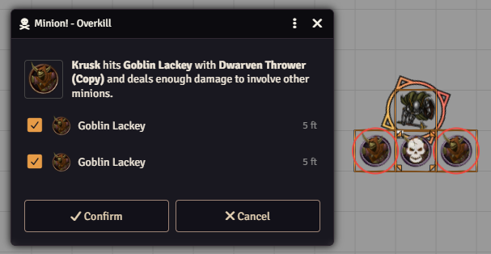
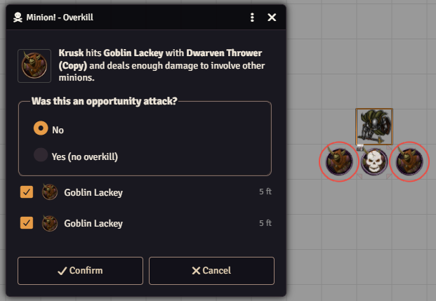
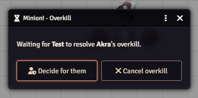
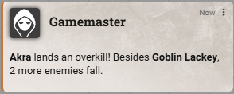
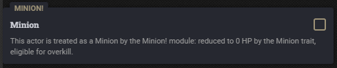
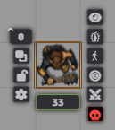
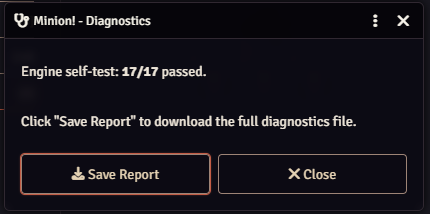

# Minion!

Minion rules for D&D 5e in Foundry VTT: the Minion trait and overkill, as described in MCDM's *Flee, Mortals!*, automated on top of Midi-QOL.



## Features

- **Minion trait.** A minion drops to 0 HP from any damage dealt by an attack or a failed saving throw. Damage from other effects (a successful save, *magic missile*, an aura) kills it only if it reaches its hit point maximum. Resistances, vulnerabilities and immunities are applied first, so a minion immune to the damage survives.
- **Overkill.** When a player character's weapon attack deals more damage than the minion's hit point maximum, the excess takes down other minions of the same kind: within reach for melee attacks, along a line one square wide up to the weapon's short range for ranged attacks.
- **Confirmation dialog.** The attacking player chooses which minions fall. The nearest ones are already selected, and a preview on the map is shown only to whoever is deciding.
- **Opportunity attacks.** Overkill can't come from an opportunity attack. When an attack happens outside the attacker's turn, or outside combat, the dialog asks.

  

- **The GM stays in control.** While a player decides, the GM can decide for them or cancel the overkill.

  

- **Chat summary** of every overkill.

  

- **Shared turns and bands** (optional). Minions of the same kind share one initiative and one turn, split into bands. See below.
- **Defeated minions** get the Dead status and, in combat, the defeated mark (left to Midi-QOL when it already applies them). Who killed each minion, and in which round and turn, is stored in `flags.minion-bang.killedBy` for statistics modules and macros.

## Requirements

| Package | Version |
|---|---|
| Foundry VTT | 14 |
| dnd5e | 5.3.2 to 5.3.x |
| [Midi-QOL](https://foundryvtt.com/packages/midi-qol) | 14.0.11 or later |
| [socketlib](https://foundryvtt.com/packages/socketlib) | any version for Foundry 14 |

Midi-QOL itself requires DAE and libWrapper, so Foundry will ask for those too.

The *Flee, Mortals!* module is **not** required. If it's installed, its minions are recognized automatically.

## Installation

In Foundry, open **Add-on Modules**, choose **Install Module** and paste this manifest URL:

```
https://github.com/therealsega87/minion-bang/releases/latest/download/module.json
```

After updating the module, every connected player should reload the browser page with **Ctrl+F5**. A normal reload can keep serving the old files from the browser cache, and the dialogs then behave like the previous version.

## Languages

The interface is available in English and Italian. Foundry picks the language set in the user's settings.

## Usage

### Marking a minion

Minions from the *Flee, Mortals!* module are recognized automatically. Any other actor can be marked as a minion in two ways, which always stay in sync:

- the **Minion** checkbox in the actor sheet's **Special Traits**;

  

- the skull button in the **Token HUD** (GM only), red while the actor is a minion.

  

Unlinked tokens keep their own copy of the actor data. Check the box on the actor before placing its tokens, or use the Token HUD button on tokens already on the scene.

From a macro:

```js
await actor.setFlag("dnd5e", "minionBangMinion", true);
```

### During play

Attack minions as usual. When an attack deals damage to a minion, Minion! applies the Minion trait. If the attack was a weapon attack by a player character and the damage exceeds the minion's hit point maximum, the overkill dialog opens for the attacking player, or for the GM when that player isn't connected. Minions that are hidden, or have the Invisible or Ethereal status, are never offered, and the others are listed with their token names.

### Shared turns and bands

Turn on **Shared turns and bands** in the module settings (world setting, off by default). It uses the native combatant groups of Foundry, so **Squad Combat Initiative must be off**.

- **Automatic groups.** Minions of the same stat block that join a combat before initiative is rolled are grouped in blocks of the size given by the table of the rules (5, 8 or 10 by challenge rating). What is left forms a smaller group. A lone minion makes no group.
- **One step in the tracker.** A band takes one turn: the GM passes the turn and the module walks through its members one by one.
- **Initiative of a group.** Chosen in the settings: the captain's roll, or the average, highest, lowest or median of the rolls of all members. Each band can also have its own mode and captain.
- **"Groups and bands" window.** The button is in the header of the combat tracker (GM only). It splits the minions of the scene into bands before the fight, with a color, a captain and a mode for each band, and adds them to the combat (creating it if needed) without rolling initiative. The tab **Existing bands** changes color, mode and captain of the bands already in the combat; mode and captain only until the band has rolled initiative.
- **Colors on the map.** Each band has a color, shown to everyone as the ring of the token (Dynamic Token Ring) or as a circle.
- **Maximum band size.** The table is editable in the settings (**Edit the table**). The default is the table of the rules: changing it affects game balance.

## Settings

- **Preselect the proposed minions** (world, on by default): when on, the overkill dialog opens with the nearest minions already checked. When off, nothing is checked and the player picks the minions; the limit still applies.
- **Shared turns and bands** (world, off by default): see above.
- **Initiative of the groups** (world, default captain's roll): how the initiative of a group is decided.
- **Maximum band size** (world): the table of the maximum creatures per band.
- **Enable Debug** (per user): detailed logs in the browser console for every damage event on a minion.
- **Run Diagnostics**: runs a self-test of the rules engine and lets you download a report with versions, settings and recent activity.

  

## Assumptions and limitations

- Midi-QOL is required: Minion! reads its damage calculation.
- Attack activities must be set up as melee or ranged weapon or spell attacks (`mwak`, `rwak`, `msak`, `rsak`). Overkill only follows weapon attacks.
- Overkill is checked when the GM is viewing the scene where the attack happens. Otherwise the hit minion still dies, but no overkill is offered.
- Damage added after the attack by on-demand automations (such as CPR, GPS and similar modules) is not counted towards overkill yet.
- Scenes measured in meters have not been tested.
- Shared turns: when the turn walks through a band, the reaction mark of the other members stays visible during the band's action, and their start-of-turn effects trigger when the turn reaches them, as it moves along. "Previous turn" goes back to the first member without start or end of turn effects.
- Bands made by the automatic grouping have no color and no captain: use the "Groups and bands" window (tab Existing bands) to give them.
- In the captain's roll mode, if the captain cannot roll, nobody rolls and the module does not warn.
- When a member of a group rolls, the group can show for a fraction of a second the value copied by dnd5e before the module sets the right one.
- In the modes Average, Highest, Lowest and Median every member rolls, so the chat gets one roll card per member, plus the summary card for the GM.

## Other modules

Combat Stats and Deep Combat Stats (modes "MidiQOL auto" and "MidiQOL manual") are handled directly: the extra minions downed by an overkill count as kills for the character who triggered the overkill. This uses two internal methods of these modules, so a future version of them may need an update of Minion!.

## Reporting a bug

Turn on **Enable Debug**, reproduce the problem, then use **Run Diagnostics** and save the report. Open an issue on [GitHub](https://github.com/therealsega87/minion-bang/issues) with the report attached and a short description of what happened.

## Credits and license

*Flee, Mortals!* is published by MCDM Productions. This module contains no content from the book: it only automates the rules, and works with minions you create or import yourself.

Released under the [MIT License](LICENSE).
