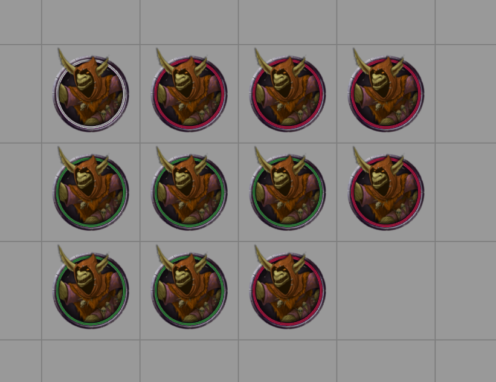

# Colors on the map

Every player sees each band's color.

- With the **Dynamic Token Ring** on, each member's ring takes the band's color.
- Without it, Minion! draws a circle in the band's color around each member.

When a minion leaves its band, or the combat ends, its ring gets its original color back.

<figure markdown="span">
  { width="640" loading=lazy }
  <figcaption>Two bands in two colors. The token with the white ring keeps its usual color: it isn't in a band.</figcaption>
</figure>

## Choosing colors

Pick each band's color in the [Groups and bands window](setup.md#what-you-can-change). Minion! has twelve colors and gives new bands ones that no other band is using. Past twelve bands, colors repeat. You can recolor a band at any time in the [Existing bands](existing.md) tab.

[Automatic groups](setup.md#automatic-groups) have no color until you give them one.
