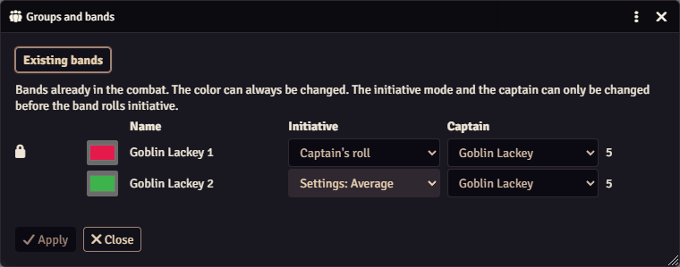

# Bands already in combat

When the current combat has bands, the Groups and bands window adds an **Existing bands** tab that lists them.

| What | You can change it |
|---|---|
| **Color** | At any time |
| **Initiative** mode | Until the band rolls initiative |
| **Captain** | Until the band rolls initiative |

A padlock marks a band that has already rolled. Its tooltip reads *"This band has already rolled initiative: the mode and the captain can no longer be changed."*

An [automatic group](setup.md#automatic-groups) shows **No captain**. Give it a color and a captain here before the roll.

Point at a band's row and its members' rings get thicker on the map. Click **Apply** to save. Minion! tells you how many bands it updated.

<figure markdown="span">
  { width="640" loading=lazy }
  <figcaption>The padlock marks a band that has already rolled. Its mode and captain are fixed.</figcaption>
</figure>
