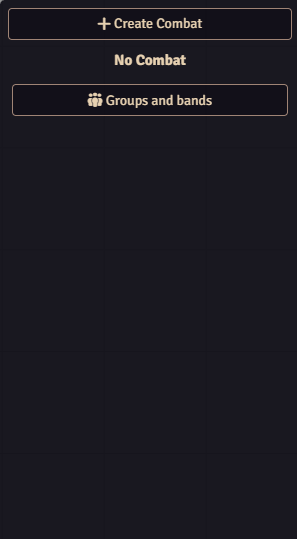
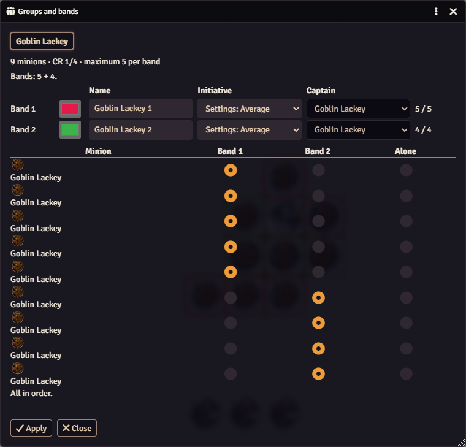
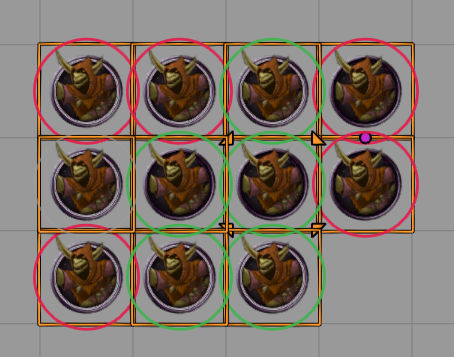

# Setting up bands

Turn on **Shared turns and bands** in the [settings](../reference/settings.md) first. Then use automatic groups, the Groups and bands window, or both.

## Automatic groups

Add minions to a combat and roll initiative as usual, without opening any window. Minion! groups the minions for you, as long as nobody in that combat has rolled initiative yet.

- Minions of the same kind are grouped in blocks of the maximum band size for their challenge rating. Seven goblins with a maximum of 5 become 5 + 2.
- A new minion first fills a group of its kind that still has room. A group with minions of more than one kind is never touched.
- A single minion left over stays alone, and joins the next minion of its kind that you add.
- Minions with no challenge rating are never grouped, and neither are minions the Groups and bands window added alone.
- Once anyone in the combat has an initiative value, even a player character, nothing more is grouped automatically.

An automatic group is named after the minion, and has no color and no captain. Give it both in the [Existing bands](existing.md) tab before the roll. Without a captain, the captain's roll mode can't set the group's initiative.

## The Groups and bands window

Use the window when you want to choose the bands, their names, their colors and their captains yourself. It also works in the middle of a fight, to bring in a new horde.

1. Place the minions on the scene. To use only some of them, select those tokens.
2. Click **Groups and bands** in the combat tracker. Only the GM sees the button, and only while **Shared turns and bands** is on.
3. If any minions are selected, the window asks **Do you want to use only the selected monsters?** Answer **Yes, only the selected ones** or **No, all the ones in the scene**.
4. The window has one tab per kind of minion. Minions already in the combat, and minions with no challenge rating, aren't listed.
5. Each tab starts with a summary, for example *"9 minions · CR 1/4 · maximum 5 per band"*, and the proposed split, for example *"Bands: 5 + 4."*
6. Adjust the bands. See below.
7. Click **Apply**. If you set up more than one kind of minion, a confirmation lists the bands and the minions left alone for each kind. Minion! then adds everyone to the combat, and creates the combat if there isn't one. **Apply never rolls initiative.**
8. Roll initiative as usual.

<figure markdown="span">
  { width="300" loading=lazy }
  <figcaption>The <strong>Groups and bands</strong> button, under <strong>Create Combat</strong>.</figcaption>
</figure>

<figure markdown="span">
  { width="640" loading=lazy }
  <figcaption>Nine goblin lackeys with a maximum of 5: the window proposes a band of 5 and a band of 4.</figcaption>
</figure>

### What you can change

| Control | What it does |
|---|---|
| **Name** | The band's name in the tracker. It can't be empty. |
| **Color** | The band's color on the map. New bands get colors no other band is using. |
| **Initiative** | How the band's initiative is decided. **Settings** follows the world [setting](../reference/settings.md). See [Initiative and captains](initiative.md). |
| **Captain** | The member whose roll counts for the band. It starts as the first member. |
| Member grid | Each minion has one button per band and one for **Alone**. Click one to move the minion there. |

Band sizes follow the [band size table](../reference/band-size.md): full bands of the maximum size, then whatever is left as a smaller band, and a single minion left alone. You can move minions around, but each band must keep its size. Each band row shows its count, for example *5 / 5*. When a count is wrong, the window says *"Band 2: it needs 5 members, it has 4."* and *"Fix the errors to be able to apply."*

!!! note "Bands of any size"
    Free band sizes and an **Add band** button are on the [roadmap](../project/roadmap.md).

### The preview on the map

While the window is open, a ring in each band's color marks its members on the scene, and a thin grey ring marks each minion staying alone. Point at a minion's row in the window and its ring gets thicker.

<figure markdown="span">
  { width="440" loading=lazy }
  <figcaption>While the window is open, rings in each band's color mark its members.</figcaption>
</figure>

### If tokens change while the window is open

If a token is deleted, or added to the combat some other way, the window names it and blocks **Apply**. Close the window and open it again.
