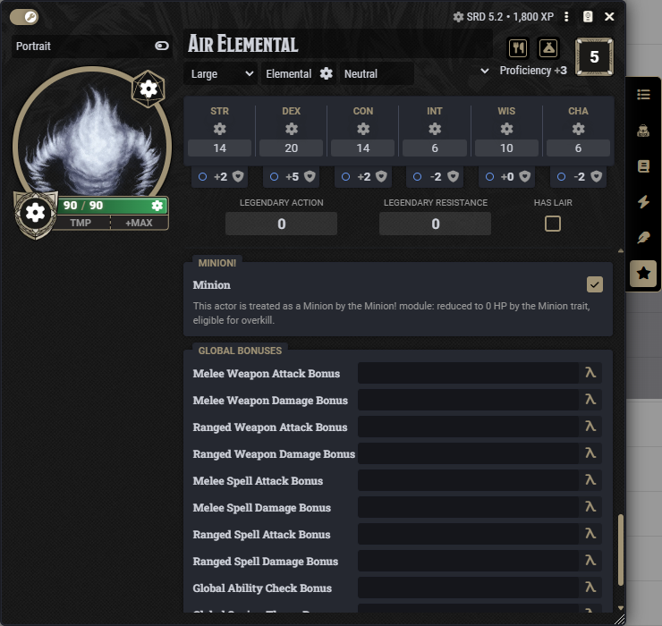
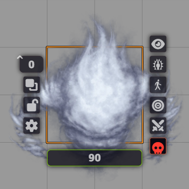

# Marking minions

Minion! treats an actor as a minion in two cases:

- the actor comes from the *Flee, Mortals!* module with the minion role. There's nothing to set up.
- you marked the actor in Minion!, with the checkbox or the Token HUD button below. Both change the same setting, so they always agree.

## The Minion checkbox

Open the actor sheet, go to **Special Traits** and check **Minion**.

<figure markdown="span">
  { width="520" loading=lazy }
  <figcaption>The <strong>Minion</strong> checkbox in <strong>Special Traits</strong>.</figcaption>
</figure>

## The Token HUD button

Right-click a token on the scene. The skull button in the Token HUD marks or unmarks the actor. Only the GM sees it, and it turns red when the actor is marked.

Minions from the *Flee, Mortals!* module count as minions without the mark, so their skull stays grey.

<figure markdown="span">
  { width="300" loading=lazy }
  <figcaption>The skull button at the bottom right of the Token HUD. It's red because the actor is marked.</figcaption>
</figure>

## Unlinked tokens

An unlinked token carries its own copy of the actor. Check the box on the actor **before** you place its tokens. For tokens already on the scene, use the Token HUD button on each one: it marks that token only.

## From a macro

```js
await actor.setFlag("dnd5e", "minionBangMinion", true);   // mark
await actor.setFlag("dnd5e", "minionBangMinion", false);  // unmark
```

To check whether an actor counts as a minion, use the [API](../developers/api-and-flags.md#isminion).

## Same kind of minion

Overkill, bands and automatic groups only mix minions of the same kind. Two minions are the same kind when they come from the same stat block: the same compendium entry, or the same actor name if the actor has no compendium source. Goblin tokens made from one compendium goblin are one kind. A goblin you built by hand and a compendium goblin are two kinds, even with the same name.

## Challenge rating

A band's maximum size depends on the challenge rating, so a minion without one is never put in a band. See [Setting up bands](../bands/setup.md).
