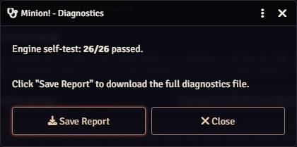

# Reporting a bug

A good report gets a faster fix, and it takes five minutes.

1. Open **Configure Settings → Minion!** and turn on **Enable Debug**.
2. Make the problem happen again.
3. Click **Run Diagnostics**. It runs a self-test of the rules engine and shows how many checks passed.
4. Click **Save Report**. The file lists your module versions, your settings and Minion!'s recent log.
5. Open an [issue on GitHub](https://github.com/therealsega87/minion-bang/issues). Attach the report and add a few lines: what you did, what you expected and what happened.

<figure markdown="span">
  { width="400" loading=lazy }
  <figcaption>The Diagnostics window. <strong>Save Report</strong> downloads the file.</figcaption>
</figure>

Two more things help: the line with the Minion! version from the browser console (++f12++), and whether everyone reloaded with ++ctrl+f5++ after the last update.

You can also write to me on [Discord](https://discord.com/users/688483231531532323): **therealsega87**.

Turn **Enable Debug** off when you're done. It fills the console fast.
