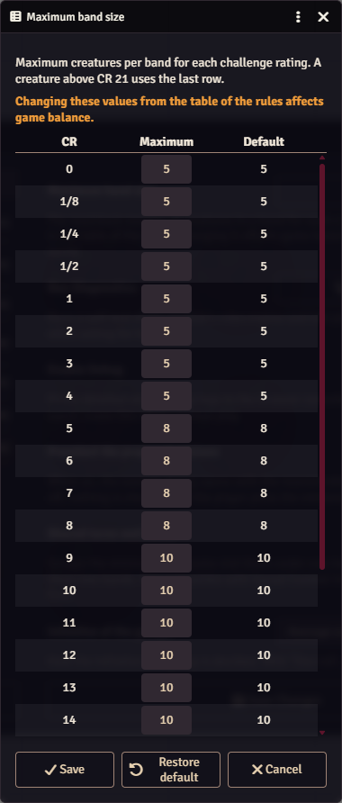

# Band size table

The table sets the **largest band** for each challenge rating. No band has more members than its row allows.

## Where the defaults come from

The defaults are the **Minions per Standard** column of the *Minion Encounter Building* table in *Flee, Mortals!*. The settings window calls it "the table of the rules". In the book, the column is for building encounters: that many minions count as one standard creature. The book doesn't limit band size, and its bands are optional. Minion! uses the column as the default band size.

| Challenge rating | Maximum band size |
|---|---|
| 0 to 4 | 5 |
| 5 to 8 | 8 |
| 9 and above | 10 |

Values from *Flee, Mortals!* by MCDM Productions. The book has the full table.

## Editing the table

1. Open **Configure Settings → Minion!**.
2. Next to **Maximum band size**, click **Edit the table**. Only the GM can.
3. Change the **Maximum** of any row. The **Default** column shows the original value.
4. Click **Save**. **Restore default** resets the whole table.

<figure markdown="span">
  { width="300" loading=lazy }
  <figcaption>The table window. <strong>Default</strong> shows each row's original value.</figcaption>
</figure>

Every maximum must be a whole number of 2 or more, or the table isn't saved. A creature above CR 21 uses the last row.

!!! warning "Balance"
    As the window warns, moving away from the table of the rules affects the balance of your encounters. The table applies to the whole world.

If the saved table gets corrupted, Minion! falls back to the default and tells the GM. Open the table from the settings to fix it.

## Where the table is used

- [Automatic groups](../bands/setup.md#automatic-groups) split minions into blocks of the maximum.
- The [Groups and bands window](../bands/setup.md) proposes bands of the maximum.
- The [`minionKill` hook](../developers/minion-kill-hook.md) reports the maximum for the dead minion's challenge rating as `minionsPerStandard`.
