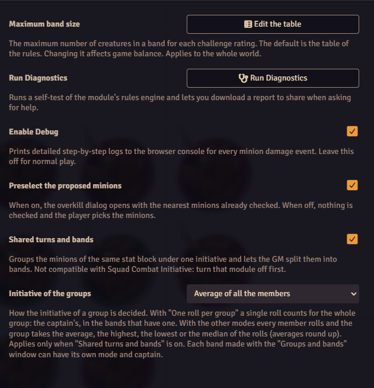

# Settings

Open **Configure Settings → Minion!**.

<figure markdown="span">
  { width="560" loading=lazy }
  <figcaption>The module settings. This world uses the average for group initiative instead of the default.</figcaption>
</figure>

| Setting | Applies to | Default | What it does |
|---|---|---|---|
| **Preselect the proposed minions** | the world | on | The [overkill dialog](../table/overkill.md#the-overkill-dialog) opens with the nearest minions checked. When off, nothing is checked and the player picks. The limit on how many can be checked still applies. |
| **Shared turns and bands** | the world | off | Turns on [automatic groups](../bands/setup.md#automatic-groups), the [Groups and bands window](../bands/setup.md#the-groups-and-bands-window), [shared turns](../bands/turns.md) and [band colors](../bands/colors.md). Doesn't work while Squad Combat Initiative is active. |
| **Initiative of the groups** | the world | One roll per group (the captain's) | How a group's initiative is decided: the captain's roll, or the average, highest, lowest or median of every member's roll. Only matters while shared turns and bands is on. Each band can use its own mode. See [Initiative and captains](../bands/initiative.md). |
| **Maximum band size** | the world | the default table | **Edit the table** opens the [band size table](band-size.md). GM only. |
| **Enable Debug** | this browser | off | Logs every damage event on a minion, step by step, in the browser console. Turn it on when you [report a bug](../help/bug-report.md). |
| **Run Diagnostics** | | | Runs a self-test of the rules engine and lets you save a report. Any user can run it. See [Reporting a bug](../help/bug-report.md). |

## Language

The interface is in English and Italian. Foundry shows each user the language they picked.
