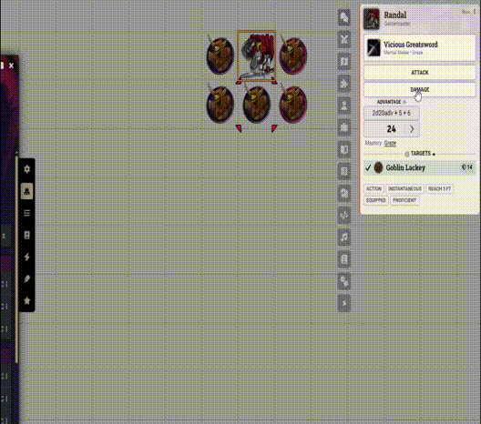
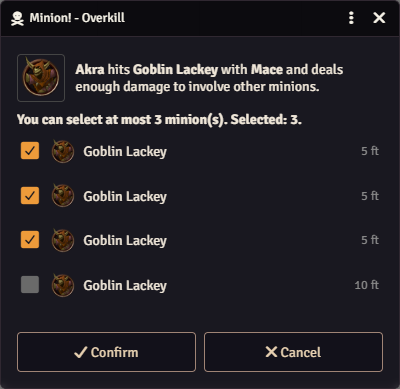
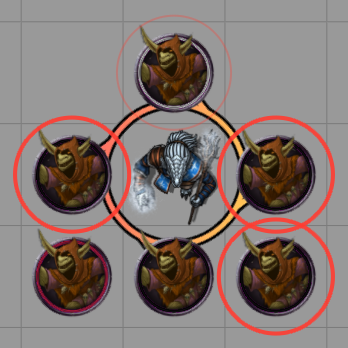
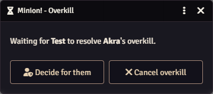
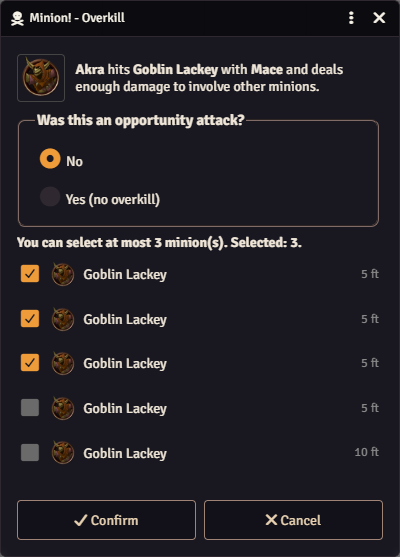
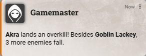

# Overkill

When a player character's weapon attack deals more damage than a minion's hit point maximum, the extra damage takes down more minions of the same kind. Akra swings at a goblin with 6 hit points and deals 20 damage. The goblin dies, and the 14 points left over are enough for three more goblins within her reach.

<figure markdown="span">
  { width="520" loading=lazy }
  <figcaption>The attack, the overkill dialog and the minions that fall.</figcaption>
</figure>

## When overkill happens

All of these must be true:

- the attacker is a **player character**, and its token is on the scene;
- the attack is a **weapon attack**, melee or ranged;
- the damage, after resistances, is higher than the minion's hit point maximum;
- at least one other minion of the same kind is in range;
- it isn't an [opportunity attack](#opportunity-attacks).

Spell attacks never cause overkill, and neither do monsters or NPCs.

## How many fall

One more minion for every hit point maximum of extra damage, rounding up. The extra damage is the damage minus the hit point maximum of the minion you hit.

| Damage | Minion's maximum | Extra damage | More minions |
|---|---|---|---|
| 20 | 6 | 14 | 3 |
| 14 | 6 | 8 | 2 |
| 7 | 6 | 1 | 1 |

The other minions' resistances don't reduce the extra damage.

## Which minions are in range

- **Melee:** the minions within the weapon's reach of the attacker, measured the way Midi-QOL measures, from the edge of one token to the edge of the other. Walls don't block it.
- **Ranged:** a line one square wide that starts at the attacker, runs through the minion you hit and is as long as the weapon's short range.

The dialog never lists the minion you hit, the other targets of the same attack, minions at 0 hit points or marked defeated, hidden tokens, or creatures with the Invisible or Ethereal status.

## The overkill dialog

The player who owns the attacker gets the dialog if they're connected. Otherwise the GM gets it.

<figure markdown="span">
  { width="400" loading=lazy }
  <figcaption>Three minions checked, the most this damage allows.</figcaption>
</figure>

- The minions nearest to the one you hit come first and are already checked. The distance next to each name is measured from the minion you hit.
- On the map, a bright red ring marks each checked minion and a faint ring marks the others in range. Only the person deciding sees the rings.
- The dialog won't let you check more minions than the damage allows. Check one more and the oldest choice is unchecked.
- Minions are listed by their token names.
- **Confirm** drops the checked minions. **Cancel**, or closing the dialog, drops none.

You can turn the preselection off in the [settings](../reference/settings.md). The dialog then opens with nothing checked, and the limit still applies.

If the extra damage could take down more minions than there are in range, the dialog says so and offers the ones in range.

<figure markdown="span">
  { width="340" loading=lazy }
  <figcaption>The same choice on the map: bright rings on the checked minions, a faint ring on the one in range that isn't checked.</figcaption>
</figure>

### While a player decides

The GM gets a waiting window: **Waiting for *player* to resolve *character*'s overkill.** **Decide for them** opens the dialog for the GM, and **Cancel overkill** ends it. Whoever answers first wins, and the other window closes.

<figure markdown="span">
  { width="360" loading=lazy }
  <figcaption>What the GM sees while the player decides.</figcaption>
</figure>

If several overkills happen at once, their dialogs open one after another.

## Opportunity attacks

Opportunity attacks never cause overkill. When an attack happens outside the attacker's turn, or with no combat running, the dialog first asks **Was this an opportunity attack?** The answer starts on **No**.

Pick **Yes (no overkill)** and the minion list goes grey, the rings disappear and the dialog reads *"Opportunity attacks cause no overkill. Press Confirm to close."* Click **Confirm**. Switch back to **No** and your choices come back.

<figure markdown="span">
  { width="400" loading=lazy }
  <figcaption>The question appears when the attack happens outside the attacker's turn.</figcaption>
</figure>

## In the chat

Every overkill ends with a chat message, for example *"Akra lands an overkill! Besides Goblin Lackey, 3 more enemies fall."*

When no overkill happens, the chat says so too, so the table knows someone decided it:

- the player or the GM cancelled it;
- the player clicked **Confirm** with no minion checked.

An opportunity attack leaves no message.

<figure markdown="span">
  { width="300" loading=lazy }
  <figcaption>The overkill message in the chat.</figcaption>
</figure>

## Who killed whom

Every minion downed by an overkill gets the same [record](../developers/api-and-flags.md#who-killed-a-minion) as the minion you hit: the attacker, the round and the turn. Statistics modules read it, and so does [Combat Stats](../reference/combat-stats.md).

## If a minion can't be downed

The others still fall. The GM gets a notification naming the minions that didn't, and the console has the details.
